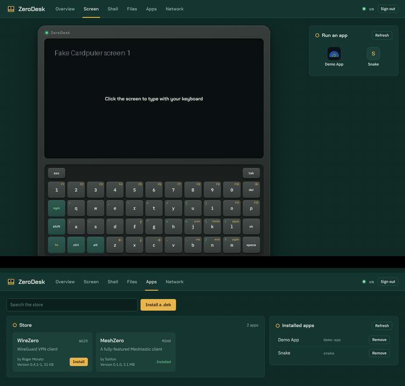

# ZeroDesk

**Control your M5Stack CardputerZero from a browser.**

Open ZeroDesk on the Cardputer, type the address it shows into a browser on the same network, and enter the one-time code. You get the Cardputer's live screen (with typing, pasting, screenshots and recordings), a shell, a file browser, app installs from the store, Wi-Fi and VPN controls, and system stats.



## How it works

1. **Open ZeroDesk.** The Cardputer shows an address like `https://192.168.1.50:8443` and a 6-digit code.
2. **Pair.** Open the address in a browser on the same network and enter the code. Your browser will warn about the certificate the first time: ZeroDesk makes its own, and the Cardputer shows the end of its fingerprint so you can check it.
3. **Use it.** Tabs for Overview, Screen, Shell, Files, Apps and Network. Apps you start from the browser run on the Cardputer while ZeroDesk keeps serving.

Installing or removing apps and joining Wi-Fi need admin rights, so the browser asks for your Cardputer password (the one `sudo` uses). It's checked, kept in memory for 5 minutes and never saved.

On the Cardputer: `4` new code, `6` sign everyone out, `8` show the full certificate fingerprint, `F`/`X` switch network, `Esc` quit (this stops the server).

## Install

ZeroDesk will be in the CardputerZero Store (share code `ZDSK`) once reviewed. Until then, build the `.deb` with `packaging/build-deb.sh` and run:

```sh
sudo apt install ./zerodesk_0.1.0-1_arm64.deb
```

Reboot once after installing so remote typing works.

## Security

- Local network only. Connections from internet addresses are refused. To use it away from home, connect to your network over a VPN first. Never forward its port on your router.
- Each code works once and expires after 5 minutes. Wrong codes pause pairing for longer each time, and after 15 wrong guesses pairing stops until someone presses `4` on the Cardputer. The device shows where wrong codes came from and which addresses are paired.
- On a network you don't trust, compare the certificate fingerprint in your browser with the one on the Cardputer (`8`) before typing the code.
- HTTPS only. Sessions live in memory, expire after 15 minutes idle or 12 hours, and end when you quit the app.
- Runs as your user, never as root. A paired browser can do anything your user can, including the shell. Admin actions also need your password; store downloads are checked against the store's SHA-256 before installing.
- Requests from other websites are refused (Origin and Host checks), and downloads are always served as files, never as pages.
- Remote typing uses a virtual keyboard. The package adds a udev rule letting the `input` group create one.

## Limitations

- Only one app at a time can be started from the browser.
- The screen is streamed as images, about 10 per second, so fast games won't feel smooth.
- Browsers show a certificate warning, since the certificate is self-signed.
- Pasting types the text with the virtual keyboard, so only characters on a US keyboard are sent.

## Development

```sh
python3 -m unittest discover -s tests   # tests
python3 -m zerodesk --dev               # web server on a PC with a fake screen
python3 -m zerodesk --sim screenshots   # render the Cardputer screen
packaging/build-deb.sh                  # build the .deb
```

## License

MIT. Includes [xterm.js](https://github.com/xtermjs/xterm.js) (MIT).
